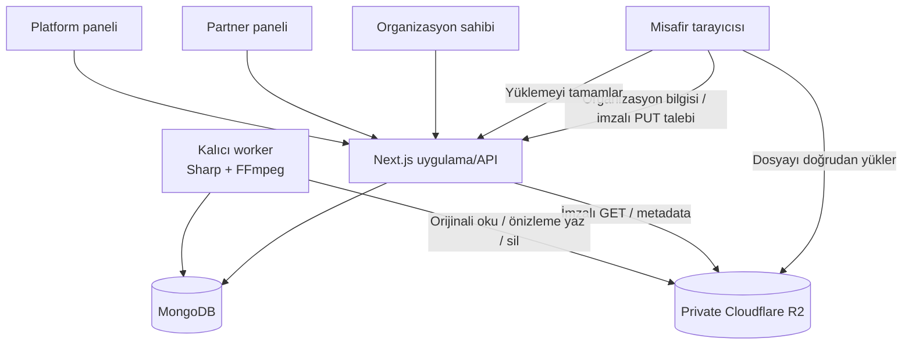

# ShineQR teknik mimari, kapasite ve risk raporu

## Yönetici özeti

Mevcut sistem, kontrollü bir ilk ticari sürüm için güçlü bir temele sahiptir: çok kiracılı rol modeli, private nesne depolama, doğrudan tarayıcıdan R2 yükleme, kalıcı önizleme üretimi, cursor tabanlı albüm sayfalama, medya sayaçları ve otomatik silme bulunur. Yerel üretim modu yük testinde 10.800 istekte hata alınmamıştır.

Buna rağmen ürün “tam operasyonel SaaS” seviyesinde değildir. Canlı satıştan önce KVKK/onay akışı, kalıcı worker, merkezi izleme, yedekleme/geri dönüş prosedürü ve gerçek üretim kabul testi zorunludur. Büyüme aşamasında tek büyük API handler'ı, süreç içi cache, sınırsız tam albüm ZIP'i ve yerel dosyaya dayalı FFmpeg worker ölçekleme sınırı oluşturur.

## Teknoloji yığını

| Katman | Teknoloji | Görev |
| --- | --- | --- |
| Web uygulaması | Next.js 16 App Router, React 19, TypeScript | Misafir sayfası, yönetim paneli ve API |
| İstemci veri yönetimi | TanStack Query | API cache, yeniden sorgulama, sonsuz medya listesi |
| Veritabanı | MongoDB | Kullanıcı, partner, organizasyon, medya metadata, oturum ve biletler |
| Nesne depolama | Cloudflare R2 / S3 API | Orijinal fotoğraf/video ve türetilmiş önizlemeler |
| Görüntü işleme | Sharp | Fotoğraf thumbnail üretimi |
| Video işleme | FFmpeg | Videodan WebP poster karesi |
| QR | `qrcode` | PNG/SVG QR ve tasarımlı kart üretimi |
| Arşiv | Archiver | Akış halinde ZIP indirme |
| Paket yönetimi | Yarn 4.9.2 | Sabitlenmiş proje bağımlılık yönetimi |

## Sistem bileşenleri

## Ana veri modeli

### `partners`

Partner işletmenin kimliği, adı, logosu, aktif/pasif durumu ve oluşturulma tarihi. Partner pasif yapılınca ilgili partner ve organizasyon sahibi hesaplarının erişimi kesilir.

### `users`

Üç rol bulunur: `platform`, `partner`, `owner`. Kullanıcılar partner kimliğiyle izole edilir. Owner hesabı tek organizasyona bağlanır ve ilk girişte parola değiştirme zorunluluğu desteklenir.

### `weddings`

Adı “wedding” olsa da model düğün, nişan, doğum günü, kurumsal etkinlik ve diğer organizasyonları taşır. Tarih, slug, tasarım, kapaklar, yükleme/saklama süreleri ve denormalize medya sayaçları tutulur.

### `media`

Orijinal R2 yolu, dosya adı/türü/boyutu, misafir adı/mesajı, yükleme zamanı, çöp ve silme zamanı, işleme durumu ve preview yolu tutulur.

### `sessions`, `upload_tickets`, `login_attempts`

- Session token'ları düz metin değil SHA-256 özetiyle tutulur.
- Upload ticket, imzalı yükleme sonrası dosyanın boyut ve MIME doğrulamasını bağlar.
- Login denemeleri 15 dakikalık pencere içinde sınırlandırılır.

## Kritik kullanıcı akışları

### Misafir yükleme akışı

1. Misafir `/wedding/[slug]` sayfasını açar.
2. API organizasyonun açık ve partnerin aktif olduğunu doğrular.
3. İstemci dosya türünü, dosya boyutunu ve parti başına en fazla 20 seçimi doğrular.
4. API en fazla bir saat geçerli upload ticket ve en fazla 15 dakika geçerli imzalı R2 PUT URL üretir.
5. Tarayıcı dosyayı Next.js sunucusundan geçirmeden doğrudan R2'ye gönderir.
6. `uploads/complete`, R2 `HEAD` ile boyut ve MIME tipini doğrular.
7. Medya kaydı `pending` olarak eklenir ve organizasyon sayaçları artırılır.
8. Worker fotoğraftan thumbnail, videodan poster üretir.

Bu tasarımın ana avantajı büyük dosya trafiğinin uygulama sunucusunu tüketmemesidir.

### Özel albüm akışı

1. Yetkili kullanıcı rol ve partner kapsamıyla doğrulanır.
2. Medya 24 kayıtlık cursor sayfalarıyla alınır.
3. Özet sayılar organizasyon belgesindeki sayaçlardan okunur; her sayfada aggregation yapılmaz.
4. Orijinal ve thumbnail için bir saatlik imzalı R2 URL üretilir ve kısa süre süreç içinde cache'lenir.
5. Filtre, arama, tarih ve boyut sıralama desteklenir.
6. Seçili veya tam albüm akış halinde ZIP olarak indirilebilir.

### Saklama ve silme akışı

- Yükleme varsayılan olarak organizasyon tarihinden 7 gün sonra kapanır.
- Medya organizasyon tarihinden 3 takvim ayı sonra sona erer.
- Silinen medya varsayılan 7 gün çöp kutusunda kalır; ana saklama sınırını aşamaz.
- Worker süresi dolan orijinal ve preview nesnelerini R2'den siler.
- Silme başarısızsa kayıt korunur ve sonraki turda yeniden denenir.

## Güvenlik değerlendirmesi

### Güçlü taraflar

- R2 bucket private tasarlanmıştır.
- Orijinal medya anahtarları API yanıtında açığa çıkarılmaz.
- Okuma/yükleme için süreli imzalı URL kullanılır.
- Platform, partner ve owner kapsamı API seviyesinde uygulanır.
- Misafirler albümü listeleyemez.
- Parolalar salt + `scrypt` ile saklanır.
- Session cookie `httpOnly`, `sameSite=lax`; production'da `secure` kullanılır.
- Mutasyon isteklerinde origin kontrolü vardır.
- Dosya türü ve boyutu hem istemcide hem sunucuda kontrol edilir.
- Partner kapatma ve parola değişiminde session cache temizlenir.

### Canlı öncesi yüksek öncelikli eksikler

| Risk | Etki | Öneri |
| --- | --- | --- |
| Açık KVKK/aydınlatma ve yükleme onayı yok | Hukuki ve güven riski | Yükleme öncesi aydınlatma bağlantısı, açık onay/işleme dayanağı ve silme talebi kanalı ekle |
| Merkezi hata izleme yok | Hatalar müşteri bildirimine kadar görünmeyebilir | Sentry/OpenTelemetry veya eşdeğeri; API, worker ve client hata uyarıları |
| Yedek/geri dönüş politikası belgeli değil | Metadata veya ayar kaybı | MongoDB PITR/snapshot, geri yükleme tatbikatı; R2 sürümleme ihtiyacını hukuki saklama politikasıyla değerlendir |
| MFA ve parola sıfırlama yok | Yönetici hesabı ele geçirilirse geniş veri erişimi | En az platform hesabında MFA; güvenli parola sıfırlama ve oturum iptali |
| Denetim günlüğü yok | Kim, neyi, ne zaman sildi bilinmez | Login, partner durum değişimi, organizasyon değişimi, indirme ve silme audit log'u |
| Public upload rate limit organizasyon bazında kaba | Kötüye kullanım tek organizasyonu doldurabilir | IP + session + event tabanlı oran sınırı, bot koruması ve gerekirse Turnstile |
| İçerik zararlı/uygunsuz olabilir | Hukuki ve operasyonel risk | Şikâyet/silme prosedürü, dosya güvenlik politikası, gerektiğinde moderasyon |

## Performans ve kapasite

### Uygulanan iyileştirmeler

- Albüm sonsuz sayfalama ve 24 kayıtlık cursor kullanıyor.
- Thumbnail ve orijinaller imzalı URL ile doğrudan R2'den sunuluyor.
- Oturum/yetki sonucu 30 saniye süreç içinde cache'leniyor.
- Fotoğraf/video/boyut sayaçları organizasyon belgesinde tutuluyor.
- R2 imzalı URL'leri süre dolumundan önce yeniden kullanılabiliyor.
- Thumbnail'ler her panel isteğinde üretilmiyor; worker kalıcı WebP üretiyor.

### Gözlenen yerel yük testi

Test koşulu: tek yerel production instance, 500 temsili medya, 30 saniyelik fazlar. Her sanal kullanıcı albüm ilk/ikinci sayfa, fotoğraf filtresi, arama ve doğrudan R2 thumbnail isteklerini tekrarladı.

| Eşzamanlı kullanıcı | İstek/sn | p50 | p95 | Hata |
| ---: | ---: | ---: | ---: | ---: |
| 5 | 27,17 | 132 ms | 188 ms | 0 |
| 10 | 52,33 | 230 ms | 324 ms | 0 |
| 30 | 58,17 | 492 ms | 918 ms | 0 |
| 50 | 68,00 | 910 ms | 1.604 ms | 0 |
| 70 | 73,17 | 963 ms | yaklaşık 1.990 ms | 0 |
| 100 | 81,17 | 1.125 ms | 2.911 ms | 0 |

Toplam: 10.800 istek, 0 hata, genel p50 746 ms, p95 1.905 ms, p99 3.972 ms; tek en kötü uç değer yaklaşık 12 sn.

### Doğru yorum

- 30 eşzamanlı panel kullanıcısına kadar deneyim güçlüdür.
- 50 kullanıcı kullanılabilir, ancak gecikme hissedilir.
- 70–100 kullanıcıda sistem hata vermemiş fakat p95 2–3 saniyeye yükselmiştir.
- Misafir upload dosya trafiği doğrudan R2'ye gittiği için panel senaryosundan farklıdır.
- Bu test internet gecikmesini, gerçek MongoDB/R2 bölgesini, mobil şebekeyi ve production hosting limitlerini kanıtlamaz.

## Ölçekleme sınırları

### 1. Tek süreç cache'i

Session ve imzalı URL cache'i bellektedir. Tek instance için uygundur. Birden fazla instance olduğunda her instance ayrı cache taşır; partner kapatma gibi değişiklikler diğer instance'ta en fazla 30 saniye gecikebilir. Çoklu instance aşamasında Redis veya paylaşımlı runtime cache değerlendirilmelidir.

### 2. Worker operasyonu

Worker bir turda sekiz preview işler; videoyu önce yerel geçici diske tamamen indirir. Büyük video ve yoğun kuyrukta disk, RAM ve CPU baskısı oluşabilir. Worker web instance'ından ayrılmalı, yeniden başlatılabilir servis olmalı ve kuyruk yaşı izlenmelidir.

### 3. Büyük ZIP

Tam albüm indirme akış halinde fakat tek API isteğinde, dosyalar sırayla R2'den geçirilerek oluşturulur. Serverless süre sınırı, reverse proxy timeout'u ve uygulama transfer maliyeti risklidir. Büyük albümlerde asenkron arşiv işi + geçici R2 ZIP nesnesi daha güvenlidir.

### 4. Tek catch-all handler

API mantığının büyük bölümü tek `handler.ts` dosyasındadır. Bu ilk sürümde hızlı geliştirme sağlar; büyüdükçe test, sorumluluk ayrımı ve değişiklik riski zorlaşır. Auth, partner, event, media, upload ve archive servislerine bölünmelidir.

### 5. Organizasyon listesi

Medya sayfalanmıştır ancak partnerin organizasyon listesi tüm kayıtları tek seferde getirir ve istemcide filtreler. Yüzlerce/binlerce organizasyonda server-side sayfalama ve arama gerekecektir.

### 6. Arama

Misafir adı/mesaj/dosya adı regex araması indeksle tam verimli değildir. Albüm başına kayıt büyüdüğünde Atlas Search veya normalize arama alanı değerlendirilebilir.

## Kod ile doküman arasındaki farklar

- `YAYIN-VE-ISLETIM.md`, thumbnail'lerin uygulama API'sinden geçtiğini söylüyor; güncel kod thumbnail'leri bir saatlik imzalı R2 URL ile doğrudan sunuyor.
- Aynı dokümanda albüm URL'leri 15 dakika denmiş; güncel varsayılan imzalı URL süresi 3.600 saniye.
- Eski finansal modelde medya trafiğinin önemli kısmı Vercel/uygulama üzerinden geçiyormuş gibi 315 TL/organizasyon trafik bütçesi var. Güncel mimaride normal görüntüleme doğrudan R2'den gider; büyük ZIP hâlâ uygulamadan geçer. Pilot faturası görülmeden bütçe düşürülmemelidir ancak model güncellenmelidir.

## Önceliklendirilmiş teknik yol haritası

### P0 — ücretli canlı organizasyondan önce

- Production domain/HTTPS ve doğru R2 CORS.
- Kalıcı worker servisi ve otomatik yeniden başlatma.
- MongoDB yedekleme ve geri yükleme denemesi.
- Hata izleme, uptime alarmı ve worker “son başarılı çalışma” alarmı.
- KVKK/aydınlatma/onay, gizlilik, saklama ve silme talebi akışı.
- Gerçek iPhone/Android ile fotoğraf, HEIC, MOV, MP4, zayıf ağ, tekrar deneme testi.
- Production R2 ile yükleme, görüntüleme, Range, ZIP, çöp ve kalıcı silme kabul testi.
- Yönetici secrets rotasyonu ve en az platform hesabı için MFA kararı.

### P1 — ilk 10 partner / ilk 50 ücretli organizasyon

- Organizasyon planı, satış bedeli, ödeme ve partner komisyon alanları.
- Toplam medya kotası ve kota uyarısı/engeli.
- Audit log ve müşteri destek ekranı.
- Worker kuyruk yaşı, başarısız preview ve depolama büyümesi metrikleri.
- Büyük ZIP için arka plan işi.
- E-posta/SMS ile owner daveti ve parola sıfırlama.
- Partner organizasyon listesinde server-side sayfalama.

### P2 — 50+ partner veya yüksek eşzamanlılık

- Çoklu uygulama instance'ı.
- Merkezi Redis/session/rate-limit cache.
- Yönetilen kuyruk ve bağımsız autoscale worker.
- CDN/edge cache stratejisi ve bölgesel gecikme ölçümü.
- Atlas Dedicated veya eşdeğer veritabanı ölçeği.
- Ayrı raporlama/analitik veri katmanı.

## Teknik kabul kriterleri

Canlıya “hazır” denebilmesi için:

- Kritik akış entegrasyon testleri production benzeri ortamda geçmeli.
- 30 eşzamanlı gerçekçi kullanıcıda API p95 hedefi tercihen 1 saniyenin altında olmalı.
- Başarısız upload oranı pilotta %1'in altında ölçülmeli.
- Worker kuyruk yaşı normal yükte 5 dakikanın altında kalmalı.
- Silinmesi gereken test nesnelerinin tamamı tanımlı süre içinde R2'den kalkmalı.
- Yedekten geri dönüş tatbikatı belgelenmeli.
- Yetkisiz partner/owner erişim testleri geçmeli.
- Uptime, API 5xx, worker hatası ve depolama büyümesi için alarm bulunmalı.

## Resmî altyapı referansları

- [Cloudflare R2 fiyatlandırması](https://developers.cloudflare.com/r2/pricing/): Standard depolama 0,015 USD/GB-ay; Class A 4,50 USD/milyon, Class B 0,36 USD/milyon; internet egress ücretsiz.
- [MongoDB Atlas Flex maliyetleri](https://www.mongodb.com/docs/atlas/billing/atlas-flex-costs/): 5 GB depolama dahil, kullanıma göre aylık 8–30 USD, 500 ops/sn sınırı; Dedicated üretim katmanı yaklaşık 60 USD/aydan başlar.
- [Vercel Pro planı](https://vercel.com/docs/plans/pro-plan): platform ücreti aylık 20 USD ve aynı tutarda aylık kullanım kredisi; ek kullanım ayrıca ücretlenir.

Fiyatlar 6 Ekim 2026 tarihinde erişilen resmî sayfalara dayanır; vergi, bölge ve kullanım nedeniyle gerçek fatura farklı olabilir.
