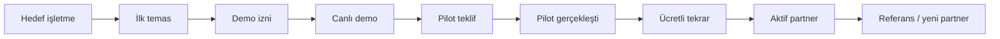

# ShineQR pazarlama senaryoları ve 90 günlük büyüme planı

## Pazarlama stratejisinin özeti

İlk aşamada geniş tüketici reklamı yerine dar bölgesel B2B satış yapılmalıdır. Ürünün değeri metinden çok canlı deneyimle anlaşılır. Bu nedenle en güçlü büyüme motoru:

> Hedefli partner listesi → kısa WhatsApp izni → canlı QR demosu → tek organizasyon pilotu → ölçülmüş sonuç → ücretli tekrar → referans.

İlk hedef “çok takipçi” değil, tekrar satış yapan partnerdir.

## Öncelikli segmentler

### Segment A — organizasyon firmaları

- Müşteriyle paket görüşmesini zaten yapar.
- ShineQR'ı ek hizmet olarak satabilir.
- Karar döngüsü genellikle mekân zincirlerine göre daha kısadır.
- İlk pilot için en güçlü segmenttir.

Mesaj: “Operasyonu düşük, sunumu güçlü yeni gelir kalemi.”

### Segment B — düğün salonu / butik otel / etkinlik mekânı

- Yüksek etkinlik hacmi potansiyeli vardır.
- Satış ekibinin ürünü paketlemesi gerekir.
- Kurumsal onay ve sözleşme süreci daha uzun olabilir.

Mesaj: “Mekân deneyimini etkinlik sonrasına taşıyan premium hizmet.”

### Segment C — fotoğrafçı/videograf

- Güven ilişkisi ve müşteri portföyü hazırdır.
- Ürünü tehdit değil tamamlayıcı olarak konumlandırmak kritiktir.

Mesaj: “Profesyonel çekime eklenen misafir gözü albümü.”

### Segment D — doğrudan çiftler

- Partner olmayan bölgelerde satış fırsatı sağlar.
- Edinme maliyeti daha yüksek olabilir.
- Tasarım, baskı ve destek operasyonu platforma kalır.

Mesaj: “Sevdiklerinizin gözünden hiçbir an kaybolmasın.”

## Satın alma senaryoları

### Senaryo 1 — partner pakete ekler

1. Partner düğün paketi görüşmesinde ShineQR'ı opsiyon olarak sunar.
2. Çift Anı Plus'ı seçer.
3. Partner sipariş formunu ShineQR'a iletir.
4. Tasarım ve QR onaylanır.
5. Partner QR kartlarını masalara yerleştirir.
6. ShineQR teknik altyapı ve destek sağlar.
7. Tahsilat/partner payı sözleşmeye göre kapanır.

En ölçeklenebilir senaryodur.

### Senaryo 2 — mekân premium pakete dahil eder

Mekân tüm premium düğün paketlerine ShineQR'ı dahil eder. Birim başına fiyat daha düşük müzakere edilebilir ancak minimum yıllık ücretli adet veya peşin kredi gerekir. Aksi hâlde hacim sözü karşılığında indirim verilmemelidir.

### Senaryo 3 — fotoğrafçı upsell yapar

Fotoğrafçı çekim paketine “misafir albümü” ekler. ShineQR, profesyonel galeriyle karıştırılmamalı; teslimat ve marka görünümü netleştirilmelidir.

### Senaryo 4 — doğrudan Instagram/Google müşterisi

Çift reklam veya içerikten gelir, WhatsApp'a geçer, üç paketten birini alır. Partner payı olmadığı durumda fiyat/katkı modeli ayrıca belirlenmelidir; %30'un tamamını otomatik “ek kâr” saymadan satış ve destek edinme maliyeti düşülmelidir.

### Senaryo 5 — kurumsal etkinlik

Ajans katılımcı içeriklerini toplamak ister. Mevcut ürün private upload ve owner albümünü destekler. Canlı sosyal duvar, moderasyon, şirket SSO'su ve özel veri işleme sözleşmesi mevcut değilse teklif kapsamına eklenmemelidir.

## Pazarlama hunisi

Her aşama sayılmalıdır. “Partner hesabı açıldı” başarı değildir; son 90 günde ücretli organizasyon üretmiş partner aktif sayılmalıdır.

## Kanal stratejisi

### 1. Kurucu satışları — en yüksek öncelik

- Fethiye ve çevresinde doğrulanmış 30–50 işletme listesi.
- Günde 5 kaliteli, kişiselleştirilmiş ilk temas.
- Haftada en az 5 canlı demo hedefi.
- Her görüşme CRM tablosuna işlenir.

### 2. WhatsApp

- İzinli, kısa ve kişiye özel mesaj.
- İlk mesajda PDF yığını değil, bir cümle değer + izin sorusu.
- İzin sonrası 30–45 saniyelik dikey demo.
- Takip aralığı 2 gün, sonra 5–7 gün; ardından kapanış.

### 3. Instagram/TikTok/Reels

İçerik sütunları:

1. “Telefonlarda kalan anlar” problemi.
2. 15 saniyelik QR → yükleme demosu.
3. Masa üstü QR tasarımı ve organizasyon estetiği.
4. Albüm ekranı ve gizlilik açıklaması.
5. Partner için ek gelir hesabı.
6. Pilot organizasyondan izinli sonuçlar.
7. Fotoğrafçıyla birlikte kullanım anlatımı.

### 4. Yerel iş birlikleri

- Fotoğrafçı stüdyolarında demo kartı.
- Düğün mekânı satış masasında QR örneği.
- Organizasyon showroom'unda fiziksel masa yerleşimi.
- Gelinlikçi, davetiye/baskı evi ve wedding planner çapraz yönlendirmesi.

### 5. Google ve web

İlk dönemde pahalı geniş reklam yerine yüksek niyetli içerikler:

- “Düğünde misafir fotoğrafları nasıl toplanır?”
- “QR kodlu düğün albümü”
- “Düğün fotoğraf yükleme QR”
- “Misafirlerin çektiği fotoğrafları toplama”

Landing page'de demo QR, paketler, gizlilik, saklama ve WhatsApp çağrısı görünmelidir.

## İçerik senaryoları

### Reels 1 — kaybolan anlar

**0–3 sn:** “Düğündeki fotoğrafların çoğu size hiç ulaşmıyor.”  
**3–8 sn:** Masada QR okutma.  
**8–15 sn:** Fotoğraf seçme ve yükleme.  
**15–22 sn:** Özel albüm ekranı.  
**22–27 sn:** “Uygulama yok. Üyelik yok. Tek özel albüm.”  
**CTA:** “Tarihiniz için demo isteyin.”

### Reels 2 — profesyonel fotoğrafçıyı tamamlar

Ekranı ikiye böl: solda profesyonel portre, sağda misafirin doğal pist görüntüsü.

> “Biri kusursuz kareleri çeker. Diğeri yaşanan bütün küçük anları toplar. ShineQR fotoğrafçının yerine değil, albümün eksik kalan tarafına gelir.”

### Reels 3 — partner geliri

> “Organizasyonunuza yeni personel veya karmaşık kurulum eklemeden dijital bir hizmet ekleyin. 5.000 TL satış örneğinde işletme payı 1.250 TL.”

Ekranda “vergi öncesi örnektir, satış garantisi değildir” notu bulunmalı.

### Reels 4 — gizlilik

> “QR'ı okutan herkes albümü görmez. Misafir yalnızca yükleme yapar; özel albüme yetkili hesaplar erişir. İçerikler belirlenen sürenin sonunda silinir.”

### Reels 5 — etkinlik günü kullanım

- Karşılama alanı QR kartı
- Masa kartı yakın çekim
- Sunucu/MC duyurusu
- Misafirin yüklemesi
- Etkinlik sonrası çiftin albümü

## Hikâye ve duyuru metinleri

### Misafir duyurusu — MC/sunucu

> “Bu güzel geceden çektiğiniz fotoğraf ve videoları masalarınızdaki QR kod üzerinden çiftimizin özel albümüne yükleyebilirsiniz. Uygulama indirmenize gerek yok; birkaç dokunuş yeterli.”

### Masa kartı kısa metni

> **Bu anı senin gözünden de görelim.**  
> QR'ı okut, fotoğrafını veya videonu özel albümümüze ekle.

### Instagram story

> “Düğünde herkes fotoğraf çekiyor. Peki kaçı çifte ulaşıyor?”  
> `[Demo videosu]`  
> “ShineQR ile hepsi tek özel albümde.”

## 90 günlük plan

### Gün 1–15 — satışa hazır temel

- Tek marka/ürün adını kesinleştir.
- Paket kapsamlarını ve 6.009 TL fiyat kararını kesinleştir.
- Partner sözleşmesi ve organizasyon sipariş formunu hukuk/muhasebe kontrolüne gönder.
- KVKK/aydınlatma/onay metinlerini hazırla.
- Production izleme, worker ve yedekleme eksiklerini tamamla.
- Bir demo organizasyonu ve 40 saniyelik dikey demo hazırla.
- CRM tablosuna ilk 50 hedef işletmeyi ekle.

Çıkış kriteri: Ürün, teklif, sözleşme, demo ve ödeme akışı tek pilotu sorunsuz başlatabilecek durumda.

### Gün 16–30 — ilk görüşmeler

- Her iş günü 5 kişiselleştirilmiş temas.
- Haftada 5 demo.
- En az 10 karar verici görüşmesi.
- 3 pilot teklif.
- Her itirazı kaydet; ürün anlatımını haftalık güncelle.

Çıkış kriteri: En az 2 tarihli pilot veya güçlü gerekçeyle değiştirilmiş hedef segment.

### Gün 31–60 — pilotlar ve kanıt

- 3–5 gerçek organizasyon.
- Her pilotta QR tarama, benzersiz yükleyici, dosya sayısı, GB, destek süresi ve başarısız yükleme ölç.
- Etkinlik sonrası partner ve çiftle 15 dakikalık değerlendirme.
- Yazılı referans ve görsel kullanım izni iste.
- Paketlerin gerçek maliyetlerini karşılaştır.

Çıkış kriteri: En az 3 tamamlanmış pilot, ölçülmüş operasyon maliyeti ve en az 1 tekrar satış niyeti.

### Gün 61–90 — tekrarlanabilir satış

- Pilot kanıtıyla sunumu güncelle.
- Başarılı segmentte 50 yeni hedefe ulaş.
- En az 5 ücretli partner veya 10 ücretli organizasyon hedefi koy; bu hedef planlamadır, garanti değildir.
- Referans programını başlat.
- İki haftada bir satış/maliyet/KPI toplantısı yap.
- Düşük dönüşümlü kanalı durdur, en güçlü kanala bütçe aktar.

Çıkış kriteri: En az iki partnerin ikinci ücretli organizasyonu üretmesi. Tekrar satış olmadan ölçekli reklam başlatılmamalıdır.

## İlk 12 aylık büyüme senaryoları

### Temkinli

- 5 aktif partner
- Partner başına 10 ücretli organizasyon
- Toplam 50 satış

Amaç: ürün-pazar uyumu ve operasyon öğrenimi. 224.000 TL sabit bütçe varsayımıyla finansal başabaş beklenmez.

### Temel

- 10 aktif partner
- Partner başına 15 ücretli organizasyon
- Toplam 150 satış

5.000 TL ana fiyat ve mevcut maliyet varsayımıyla pozitif bütçe sonucu mümkündür; sezon, tahsilat ve şirket giderleri ayrıca izlenmelidir.

### Güçlü büyüme

- 10 aktif partner
- Partner başına 25 ücretli organizasyon
- Toplam 250 satış

Bu senaryo mevcut eski planın potansiyelidir; tüm partnerlerin yüksek kullanım üretmesini varsayar ve garanti değildir. Worker, destek, ZIP ve veritabanı kapasitesi canlı metriklerle yeniden doğrulanmalıdır.

## Pazarlama KPI'ları

### Satış hunisi

- Yeni hedef işletme
- İlk temas
- Yanıt oranı
- Demo kabul oranı
- Gerçekleşen demo
- Pilot teklif
- Pilot kabul
- Ücretli organizasyon
- İkinci ücretli organizasyon
- Aktif partner
- Kaybedilme nedeni

### Ürün kullanımı

- QR tarama sayısı
- Benzersiz yükleyici oturumu
- Yükleme başlatma/tamamlama oranı
- Yükleyen misafir oranı
- Organizasyon başına fotoğraf/video/adet/GB
- Başarısız yükleme ve tekrar deneme
- Albüm görüntüleme ve ZIP indirme
- Silme zamanı geldiğinde kalan medya

### Operasyon ve finans

- Organizasyon kurulum süresi
- Destek dakikası
- Baskı/kargo maliyeti
- Değişken altyapı maliyeti
- Tahsilat süresi ve gecikme
- İade/iptal oranı
- Partner payı ödeme süresi
- Paket bazında katkı
- Partner başına ücretli satış

## Deney planı

Her pazarlama deneyi tek soruya cevap vermeli:

| Deney | Hipotez | Ölçüm | Durdurma/başarı ölçütü |
| --- | --- | --- | --- |
| Canlı QR vs video demo | Canlı deneyim demo kabulünü artırır | Demo→pilot oranı | En az 20 görüşmede karşılaştır |
| Partner mesajı vs çift mesajı | Gelir mesajı B2B'de daha güçlüdür | Yanıt/demo oranı | Segment başına en az 30 temas |
| 3 paket vs tek paket | Üç paket 5.000 TL seçimini artırır | Paket seçimi ve kapanış | En az 20 teklif |
| 10 vs 20 QR kartı | Fiziksel görünürlük yükleme oranını artırır | Yükleyen misafir oranı | Benzer boyutta en az 5+5 etkinlik |
| MC duyurusu | Duyuru katılımı artırır | QR tarama/yükleme | Benzer etkinliklerde karşılaştır |

Örneklem küçükken kesin nedensellik iddiası yapılmamalı; sonuçlar yön gösterici kabul edilmelidir.

## Pazarlamada yapılmaması gerekenler

- Gerçek pilot kanıtı olmadan büyük reklam bütçesi.
- İzin almadan düğün fotoğrafı/müşteri adı paylaşmak.
- “Sınırsız”, “sonsuz”, “%100 güvenli” veya “kesin kazanç” demek.
- Partnerin müşterisini doğrudan kendine çekmek.
- Her segmente aynı metni göndermek.
- İlk mesajda uzun PDF ve fiyat tablosu göndermek.
- Satış sayısını partner hesabı sayısıyla karıştırmak.
- İndirimle problem çözmeye çalışmak; önce itirazın gerçek nedenini anlamamak.
