# ShineQR operasyon, sözleşme, KPI ve kontrol listeleri

## Bu belgenin amacı

Satıştan organizasyonun kalıcı silinmesine kadar yapılacak işi standartlaştırır. Bu bir hukuk metni değildir; sözleşme ve KVKK belgeleri avukat, fatura/vergi akışı mali müşavir tarafından hazırlanmalı veya onaylanmalıdır.

## Uçtan uca operasyon

```mermaid
flowchart LR
  A[Lead] --> B[Demo]
  B --> C[Teklif]
  C --> D[Sözleşme ve ödeme]
  D --> E[Organizasyon kurulumu]
  E --> F[Tasarım/QR onayı]
  F --> G[Etkinlik öncesi test]
  G --> H[Etkinlik]
  H --> I[Albüm ve destek]
  I --> J[İndirme hatırlatması]
  J --> K[Kalıcı silme]
  K --> L[Kapanış ve KPI]
```

## Sorumluluk matrisi

| İş | ShineQR | Partner | Organizasyon sahibi |
| --- | --- | --- | --- |
| Platform ve depolama | Sorumlu | Bilgilendirilir | Bilgilendirilir |
| Partner hesabı | Sorumlu | Parolayı değiştirir/korur | — |
| Organizasyon bilgisi | Kontrol eder | Toplar ve doğru iletir | Onaylar |
| Tasarım/QR | Üretir veya araç sağlar | Kontrol eder | Son onay |
| Baskı | Paket/sözleşmeye göre | Teslim alır/yerleştirir | — |
| Etkinlikte QR görünürlüğü | Rehber sağlar | Uygular | Duyuruya destek olur |
| Misafir yüklemesi | Teknik altyapı | İlk seviye yönlendirme | — |
| Özel albüm | Yetkilendirme/altyapı | Erişebilir | Erişir ve indirir |
| Süre hatırlatması | Sistem/operasyon | Müşteriye ulaştırır | Süre dolmadan indirir |
| Kalıcı silme | Worker ve kontrol | Bilgilendirir | Kabul eder |
| Tahsilat/partner payı | Sözleşmeye göre | Sözleşmeye göre | Öder |

## Partner onboarding kontrol listesi

- [ ] Partner sözleşmesi imzalandı.
- [ ] Vergi/fatura bilgileri alındı.
- [ ] Karar verici ve operasyon sorumlusu belirlendi.
- [ ] Partner hesabı açıldı.
- [ ] Geçici parola güvenli kanaldan iletildi.
- [ ] İlk girişte parola değiştirildi.
- [ ] Partner logosu ve marka kullanım izni alındı.
- [ ] Paket/fiyat/pay modeli anlatıldı.
- [ ] Müşteriye söylenmemesi gereken ifadeler anlatıldı.
- [ ] KVKK ve müşteri onay akışı anlatıldı.
- [ ] Demo organizasyonu birlikte oluşturuldu.
- [ ] QR PNG/SVG indirildi ve test edildi.
- [ ] Owner hesabı oluşturma akışı gösterildi.
- [ ] Destek kanalı ve saatleri paylaşıldı.
- [ ] İlk pilot tarihi CRM'e yazıldı.

## Organizasyon sipariş kontrol listesi

### Satış ve bilgi toplama

- [ ] Müşteri/partner adı
- [ ] Paket ve KDV dahil fiyat
- [ ] Tahsilat koşulu ve durum
- [ ] Partner payı ve ödeme zamanı
- [ ] Etkinlik türü, tarih, saat ve mekân
- [ ] İsimler, başlık ve özel mesajlar
- [ ] Kapak fotoğrafları için kullanım izni
- [ ] Partner logosu
- [ ] Baskı adedi ve teslim adresi
- [ ] Tasarım son onay tarihi
- [ ] İptal/tarih değişikliği şartı kabulü

### Teknik kurulum

- [ ] Organizasyon doğru partnere bağlı.
- [ ] Benzersiz ve okunabilir slug oluşturuldu.
- [ ] Yükleme kapanış ve kalıcı silme tarihleri kontrol edildi.
- [ ] Kapaklar doğru yön/kırpma ile yüklendi.
- [ ] Açılış animasyonu ve tema doğru.
- [ ] QR gerçek production alan adına gidiyor.
- [ ] PNG ve SVG QR indirildi.
- [ ] Owner hesabı oluşturuldu.
- [ ] Geçici parola kaydedildi ve güvenli iletildi.
- [ ] Owner ilk girişte parolayı değiştirdi.

### Etkinlik öncesi kabul

- [ ] En az bir iPhone ve bir Android ile QR tarandı.
- [ ] Mobil veri üzerinden sayfa açıldı.
- [ ] JPG/HEIC fotoğraf yüklendi.
- [ ] MP4/MOV video yüklendi.
- [ ] Yönetim panelinde thumbnail/poster oluştu.
- [ ] Owner albümü gördü ve indirme yaptı.
- [ ] Misafirin albümü göremediği doğrulandı.
- [ ] QR baskı boyutu ve kontrastı gerçek baskıda test edildi.
- [ ] Mekân internet koşulu ve alternatif duyuru planı kontrol edildi.

### Etkinlik sonrası

- [ ] Yükleme/adet/GB ve hata metrikleri kaydedildi.
- [ ] Owner'a albüm bağlantısı ve indirme bilgisi iletildi.
- [ ] Son indirme tarihi açıkça bildirildi.
- [ ] İlk indirme yapıldı mı takip edildi.
- [ ] Destek talebi ve harcanan dakika kaydedildi.
- [ ] Partner/owner geri bildirimi alındı.
- [ ] Yazılı referans ve içerik kullanım izni ayrı ayrı soruldu.
- [ ] Partner payı/fatura süreci kapatıldı.

## Canlı sistem günlük/haftalık operasyonu

### Günlük

- Uptime ve API 5xx kontrolü.
- Worker son başarılı çalışma zamanı.
- Preview hata sayısı ve üç denemeyi tüketmiş kayıtlar.
- Süresi dolduğu hâlde silinememiş medya.
- R2/Mongo bağlantı hataları.
- Yeni ücretli organizasyon ve yaklaşan etkinlikler.

### Haftalık

- Partner bazında satış ve aktif organizasyon.
- Başarısız yükleme ve destek talepleri.
- Depolama büyümesi ve tahmini fatura.
- Yaklaşan silme tarihleri ve indirme hatırlatmaları.
- Güvenlik/audit olayları.
- Yedekleme sonucu.

### Aylık

- Gelir, tahsilat, partner payları.
- Paket bazında katkı ve gerçek değişken maliyet.
- Aktif/uyuyan partner.
- Huni dönüşüm oranları.
- MongoDB, R2, hosting ve izleme faturası.
- Yedekten geri dönüş örneklemesi/tatbikat takvimi.
- Erişim yetkisi ve eski hesap temizliği.

## KPI sözlüğü

| KPI | Tanım | Neden önemli? |
| --- | --- | --- |
| Aktif partner | Son 90 günde en az 1 ücretli organizasyon üreten partner | Hesap sayısından daha gerçek büyüme ölçer |
| Tekrar satış oranı | İkinci ücretli organizasyonu yapan partner / ilk satışı yapan partner | Ürün-pazar uyumunun ana kanıtı |
| Demo→pilot | Pilot kabul / gerçekleşen demo | Satış mesajının gücü |
| Pilot→ücretli tekrar | Ücretli tekrar / tamamlanan pilot | Pilotların ticari değeri |
| Yükleyen misafir oranı | Benzersiz yükleyici / tahmini misafir | QR yerleşimi ve deneyim kalitesi |
| Upload başarı oranı | Tamamlanan dosya / başlatılan dosya | Teknik kalite |
| Organizasyon GB | Aktif medya toplam boyutu | Maliyet ve kota planı |
| Destek dakikası | Organizasyon için toplam insan emeği | Gerçek değişken maliyet |
| Katkı | ShineQR net payı − değişken maliyet | Paket ekonomisi |
| Tahsilat günü | Fatura/talep ile ödeme arasındaki gün | Nakit akışı |
| Worker kuyruk yaşı | En eski pending medyanın yaşı | Operasyon sağlığı |
| Kalıcı silme gecikmesi | Son tarih ile fiziksel silme arasındaki süre | Veri politikası uyumu |

## Haftalık yönetim tablosu

| Alan | Bu hafta | Geçen hafta | Hedef | Not |
| --- | ---: | ---: | ---: | --- |
| Yeni hedef işletme |  |  | 25 |  |
| Gerçekleşen demo |  |  | 5 |  |
| Pilot teklif |  |  | 3 |  |
| Ücretli organizasyon |  |  |  |  |
| Tekrar satış |  |  |  |  |
| Tahsilat |  |  |  |  |
| Ortalama destek dk |  |  | ≤20 |  |
| Upload başarı oranı |  |  | ≥%99 |  |
| API p95 |  |  | <1 sn normal yük |  |
| Worker hata |  |  | 0 kritik |  |

## Ana partner sözleşmesi taslak başlıkları

Hukuk danışmanına verilecek kapsam listesi:

1. Taraflar ve tanımlar
2. Sözleşmenin konusu
3. ShineQR hizmet kapsamı
4. Partnerin satış ve bilgilendirme yükümlülüğü
5. Paketler ve ek hizmetler
6. Fiyat, KDV ve fiyat değişikliği
7. Tahsilat, fatura ve partner payının belgelenmesi
8. Siparişin kesinleşmesi
9. İptal, iade, erteleme ve mücbir sebep
10. QR baskı, teslimat, kargo ve tekrar baskı
11. Hizmet süresi, yükleme kapanışı ve saklama
12. İndirme sorumluluğu ve kalıcı silme
13. Kişisel veri rolleri ve veri işleme eki
14. Gizlilik ve hesap güvenliği
15. Fikrî mülkiyet, marka ve içerik kullanım izni
16. Hizmet seviyesi ve destek kapsamı
17. Yasaklı içerik ve kötüye kullanım
18. Sorumluluk sınırları
19. Süre, fesih ve fesih sonrası aktif siparişler
20. Uyuşmazlık ve tebligat

## Son müşteri hizmet formu başlıkları

- Satın alınan paket ve dahil hizmetler
- Toplam bedel, KDV ve ödeme planı
- Etkinlik bilgileri
- Tasarım/baskı onay prosedürü
- Yükleme başlangıç/bitiş tarihi
- Saklama ve kalıcı silme tarihi
- Owner hesabı ve albüm erişimi
- Dosya türü/boyut/kullanım sınırları
- İndirme ve fiziksel arşiv sorumluluğu
- İnternet bağlantısına bağlı çalışma açıklaması
- İptal, erteleme, iade
- KVKK aydınlatma ve gerekli izinler
- Referans/portföy izninin hizmet onayından ayrı seçilmesi

## KVKK ve veri yönetişimi karar listesi

Avukatla yanıtlanması gereken sorular:

- Partner, ShineQR ve organizasyon sahibi hangi süreçte veri sorumlusu/veri işleyen?
- Misafir adı, mesajı, fotoğrafı, videosu ve teknik loglar hangi hukuki dayanakla işleniyor?
- Yükleme ekranında hangi aydınlatma ve onay gerekiyor?
- Çocuk görüntüleri ve özel nitelikli veri içeren içerikler için politika nedir?
- İlgili kişi erişim/silme talebi hangi kanaldan alınır ve nasıl doğrulanır?
- Yurt dışı altyapı sağlayıcılarına veri aktarımı için hangi sözleşme/izin gereklidir?
- Saklama süresi ve yedeklerde silme nasıl belgelenir?
- Veri ihlali müdahale planı ve bildirim sorumlusu kimdir?
- Partner sözleşmesine veri işleme eki gerekli mi?

## Olay müdahale planı

### Seviye 1 — tek müşteri sorunu

Örnek: bir dosya yüklenmiyor, bir thumbnail oluşmuyor.

1. Organizasyon ve dosya kimliğini al.
2. Gizli URL/anahtar istemeden logları kontrol et.
3. Upload ticket, R2 nesnesi ve media kaydını karşılaştır.
4. Gerekirse worker retry başlat.
5. Sonuç ve önleyici aksiyonu kaydet.

### Seviye 2 — hizmet kesintisi

1. Yeni satış/demo trafiğini durdur veya durum mesajı yayınla.
2. Uygulama, MongoDB, R2 ve worker'ı ayrı ayrı kontrol et.
3. Veri kaybı riski varsa mutasyonları sınırlamayı değerlendir.
4. Etkilenen partnerlere doğrulanmış durum ve sonraki güncelleme saatini bildir.
5. Düzeldikten sonra postmortem yaz.

### Seviye 3 — yetkisiz erişim/veri ihlali şüphesi

1. Erişimi kes, ilgili session/anahtarları iptal et.
2. Log ve kanıtları değiştirmeden koru.
3. Kapsamı belirle; hangi organizasyon/medya/hesap etkilendi?
4. Hukuk/KVKK danışmanını devreye al.
5. Bildirimleri yasal gereklilik ve doğrulanmış bilgiyle yap.
6. Anahtar rotasyonu, parola sıfırlama ve güvenlik düzeltmesini uygula.

## Canlıya çıkış kapısı

### Hukuk/ticaret

- [ ] Şirket ve fatura akışı hazır
- [ ] Partner sözleşmesi onaylı
- [ ] Son müşteri formu onaylı
- [ ] KVKK/aydınlatma/onay yayında
- [ ] İptal/iade ve fiyat politikası yazılı

### Teknik

- [ ] Production domain ve HTTPS
- [ ] Private R2 ve doğru CORS
- [ ] Production MongoDB ve yedek
- [ ] Worker kalıcı servis
- [ ] Uptime/API/worker uyarıları
- [ ] iPhone/Android gerçek medya testi
- [ ] ZIP ve Range testi
- [ ] Otomatik silme testi
- [ ] Secret rotasyonu ve erişim kontrolü

### Satış/operasyon

- [ ] Tek marka ve paket isimleri
- [ ] Güncel partner sunumu
- [ ] 40 saniyelik demo videosu
- [ ] Fiziksel demo QR kartı
- [ ] CRM ve görüşme notu şablonu
- [ ] Destek kanalı/SLA
- [ ] İlk pilot tarihleri
- [ ] KPI toplama yöntemi

## Karar günlüğü

Aşağıdaki tablo planlama sırasında güncellenmelidir:

| Karar | Seçenekler | Karar | Tarih | Gerekçe / sahibi |
| --- | --- | --- | --- | --- |
| Ana marka | ShineQR / ANILAR / ShineQR Anılar |  |  |  |
| 6.009 TL | Koru / 6.000 / 5.990 / 6.250 |  |  |  |
| Fatura kesen | ShineQR / partner |  |  |  |
| Partner modeli | %30 paylaşım / toptan kredi |  |  |  |
| Baskı sorumlusu | ShineQR / partner |  |  |  |
| Paket kotaları | Adet / GB / adil kullanım |  |  |  |
| Hosting | Vercel / VPS / hibrit |  |  |  |
| MongoDB | Flex / Dedicated |  |  |  |
| İlk bölge | Fethiye / Muğla geneli |  |  |  |

## İlk planlama toplantısının gündemi

1. Marka ve ürün adı — 15 dk
2. Üç paketin kesin kapsamı — 30 dk
3. 6.009 TL fiyat kararı — 10 dk
4. Fatura/tahsilat/partner payı — 30 dk
5. Baskı/kargo operasyonu — 15 dk
6. KVKK ve sözleşme sorumluları — 20 dk
7. Production teknik eksikler — 20 dk
8. İlk 20 partner hedefi ve demo takvimi — 20 dk
9. İlk pilot başarı kriterleri — 15 dk
10. Sahipler ve son tarihler — 15 dk

Toplantı çıktısı yalnızca konuşma değil; doldurulmuş karar günlüğü, sorumlu kişi ve tarih olmalıdır.
